# Tests and working demonstration

Screenshots taken on the real hardware while running the demo of the **8b image** on 2026-11-19. The Orin's own clock shows 2025-06-26 because it has no RTC battery and no time sync at first boot, so ignore the timestamps shown by the board. Screenshot window titles say `marsuser@marsnew`, because the workstation was used as the terminal for the serial console and for SSH.

Not every test was captured, and some checks are shown only in the report numbers. Gaps are noted at the end.

## 1. Flash

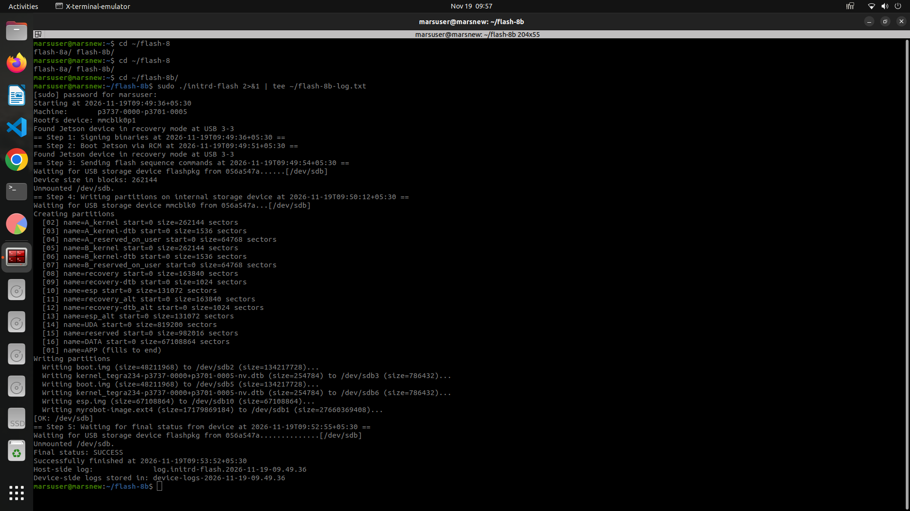

**`initrd-flash` of the 8b image.** `Machine: p3737-0000-p3701-0005`, 16 partitions created (including `DATA`), `myrobot-image.ext4` written, `Final status: SUCCESS`, finished in about 4 min. See [`FLASH_LOGS.md`](FLASH_LOGS.md).

## 2. First boot and what the OS is

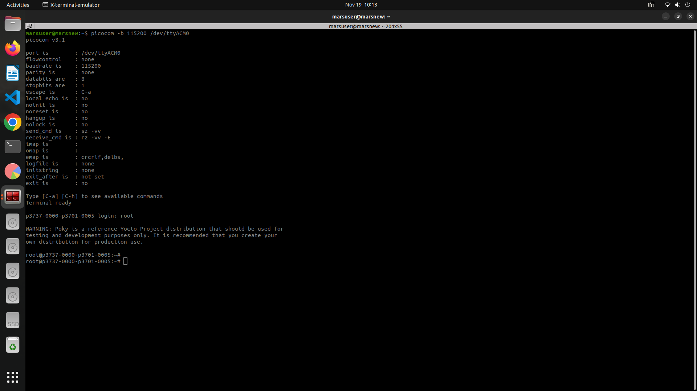

**Serial console login** (picocom, 115200 baud) on `p3737-0000-p3701-0005`.

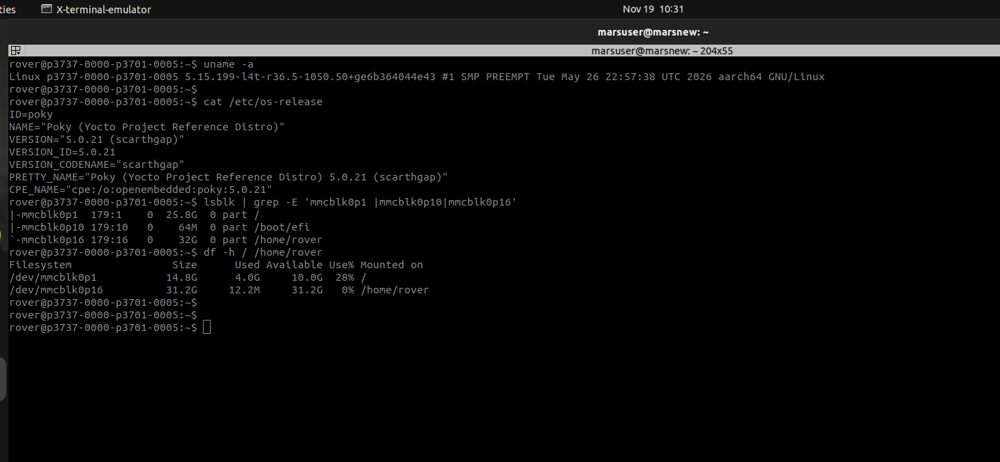

**Kernel, distro and storage.** Linux `5.15.199-l4t-r36.5-1050.50+ge6b364044e43 #1 SMP PREEMPT`, Poky 5.0.21 (scarthgap). `/` is `mmcblk0p1` (14.8 GB, 28% used, 4.0 GB), the ESP is `mmcblk0p10`, and **`/home/rover` is the separate `mmcblk0p16`, 32 GB**. The kernel line shows `PREEMPT`, which is why this is not claimed to be real-time.

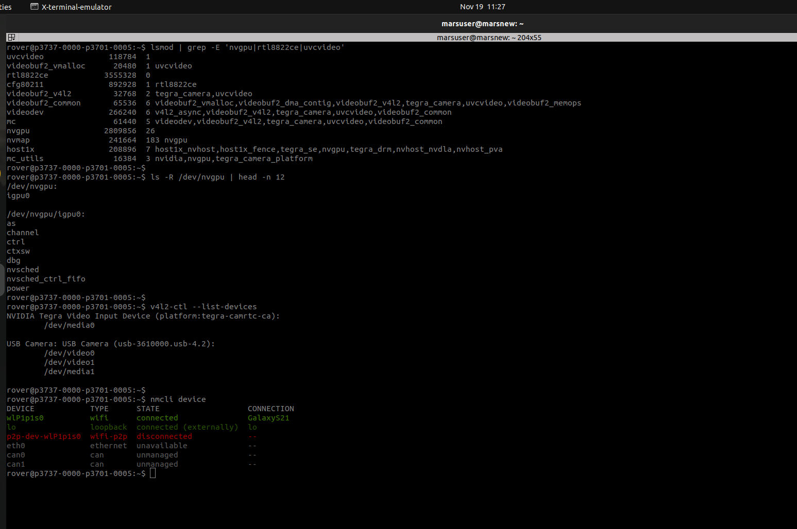

**GPU, Wi-Fi and camera drivers loaded.** `nvgpu`, `rtl8822ce` (with `cfg80211`) and `uvcvideo` are loaded, `/dev/nvgpu/igpu0` exists, the USB camera is listed by `v4l2-ctl` as `/dev/video0`, and NetworkManager shows `wlP1p1s0` connected.

## 3. Wi-Fi and remote access

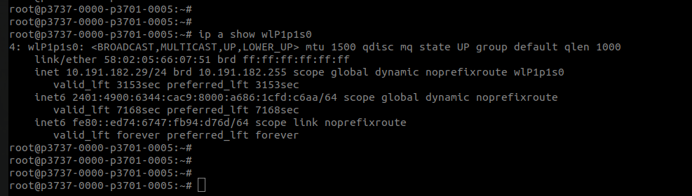

**Wi-Fi interface up.** `wlP1p1s0` has IPv4 `10.191.182.29/24` and a global IPv6 address, from a phone hotspot.

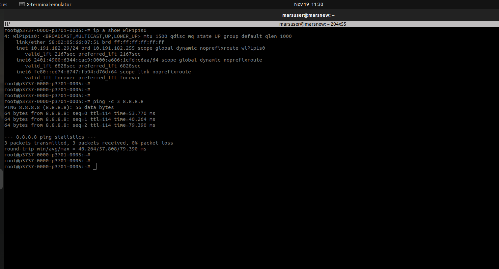

**Internet connectivity over Wi-Fi.** `ping 8.8.8.8`: 3/3 received, 0% loss, average 57.8 ms.

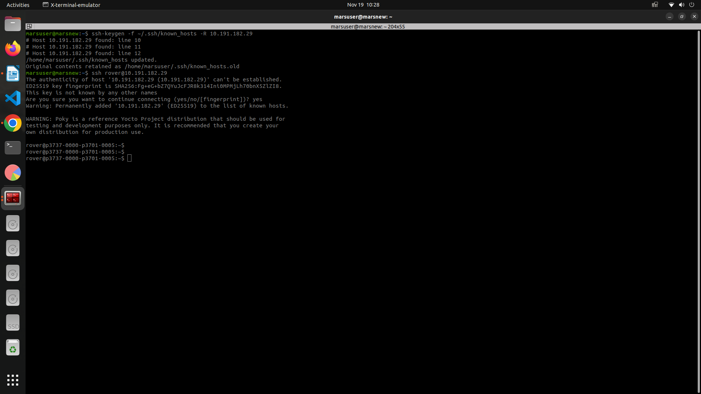

**SSH key login as `rover`.** The first connection asks to trust the host key, then gives a shell with no password prompt.

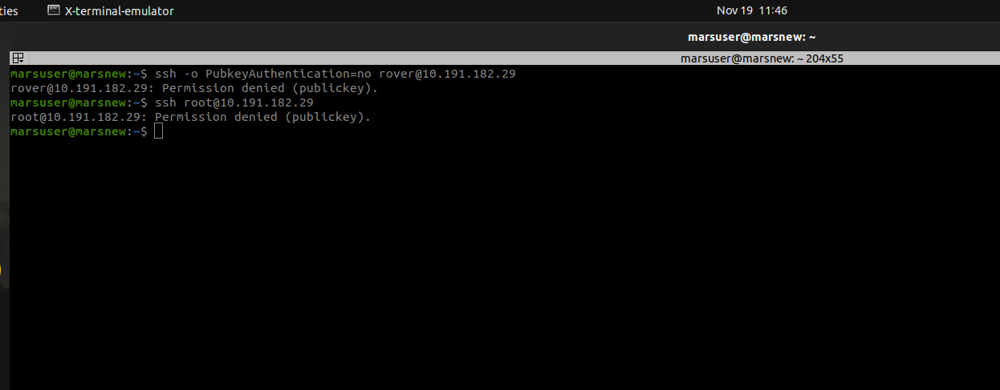

**Password and root login refused.** `ssh -o PubkeyAuthentication=no rover@...` and `ssh root@...` both end in `Permission denied (publickey)`.

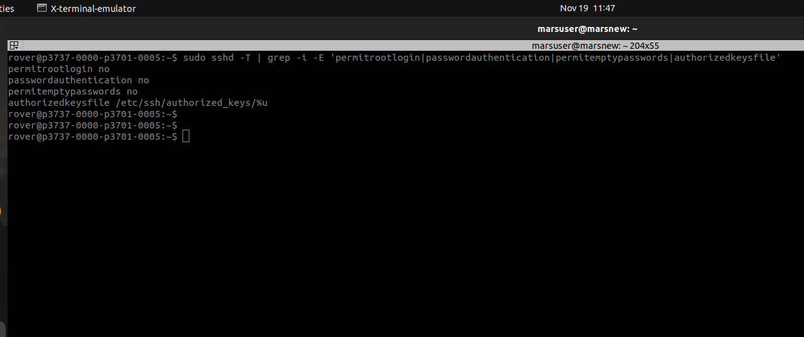

**Effective sshd settings** (`sshd -T`): `permitrootlogin no`, `passwordauthentication no`, `permitemptypasswords no`, `authorizedkeysfile /etc/ssh/authorized_keys/%u`.

## 4. Lean system

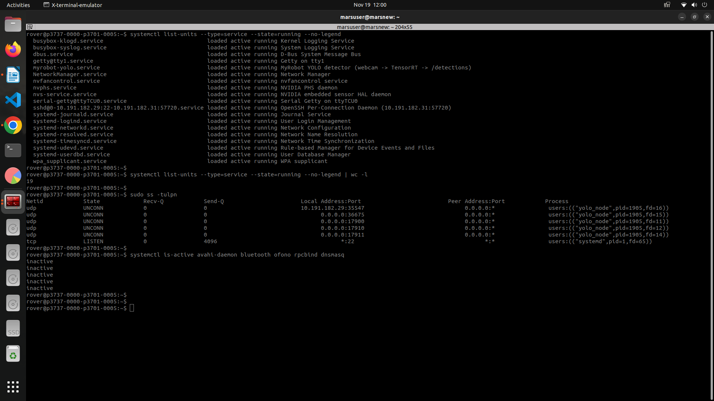

**19 running services**, with no avahi, bluetooth, ofono, rpcbind or dnsmasq (`systemctl is-active` prints `inactive` five times). **The only TCP listener is port 22.** The UDP sockets belong to `yolo_node` (ROS 2 / DDS).

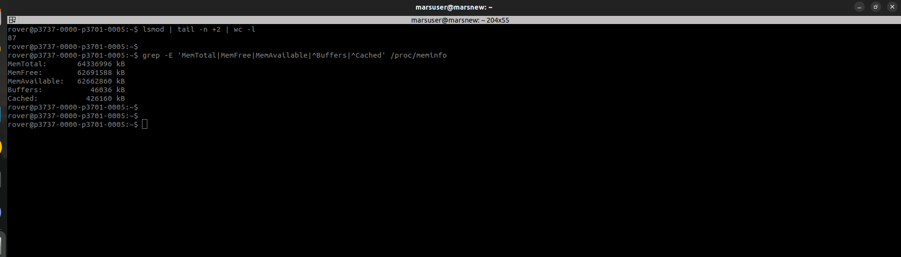

**Memory.** `MemTotal` 64,336,996 kB, `MemFree` 62,691,588 kB, `Buffers` 46,036 kB, `Cached` 426,160 kB. Used (`total - free - buffers - cached`) is 1,173,212 kB, or **1.12 GiB**. `lsmod` shows **87 modules**.

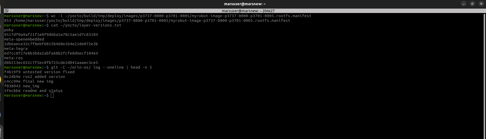

**Package manifest and layer revisions.** The image manifest has **853** lines (packages). The layer commits are those pinned in [`evidence/layer-versions.txt`](../evidence/layer-versions.txt). The last lines show the repo history on the workstation.

## 5. The AI application

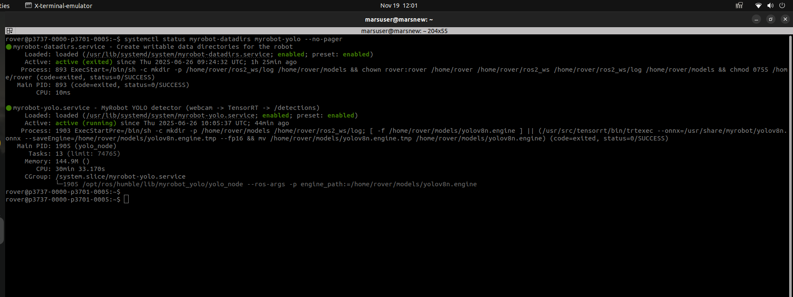

**`myrobot-datadirs` and `myrobot-yolo` running under systemd**, both `enabled`. The detector had been restarted by hand earlier in the session (it started after `myrobot-datadirs`). It uses about 145 MB in this capture, and its `ExecStartPre` found the TensorRT engine already built.

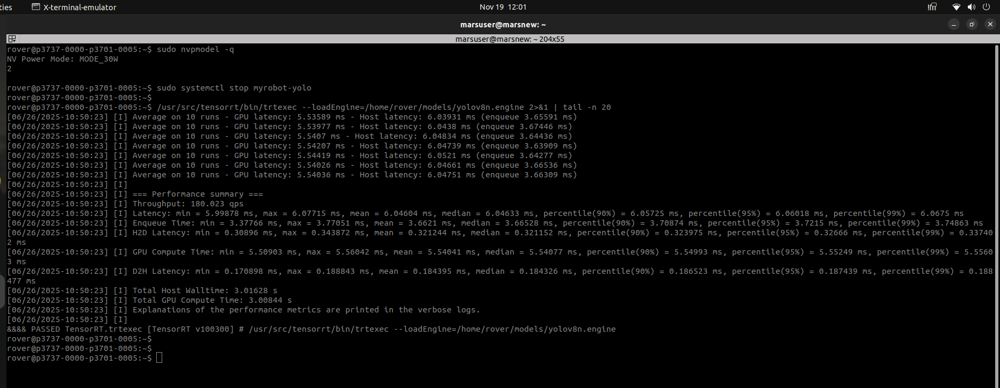

**TensorRT benchmark of the YOLOv8n FP16 engine** at `MODE_30W`. GPU compute mean **5.54 ms**, throughput **180 qps**, host latency about 6.05 ms (p99 6.07 ms). `PASSED TensorRT.trtexec [TensorRT v100300]`.

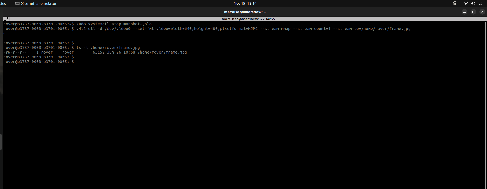

**Camera capture test** with `v4l2-ctl`: 640x480 MJPG frame written to a file (63,152 bytes).

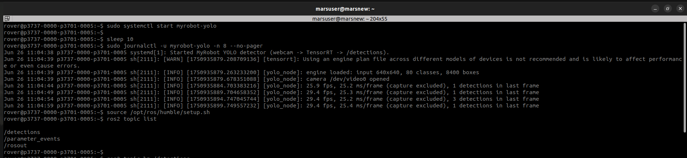

**Detector log.** `engine loaded: input 640x640, 80 classes, 8400 boxes`, `camera /dev/video0 opened`, then **29.4 fps, 25.2 ms/frame** (capture excluded). The `[WARN]` about engine plans across different devices is TensorRT's generic message; the engine was built on this board.

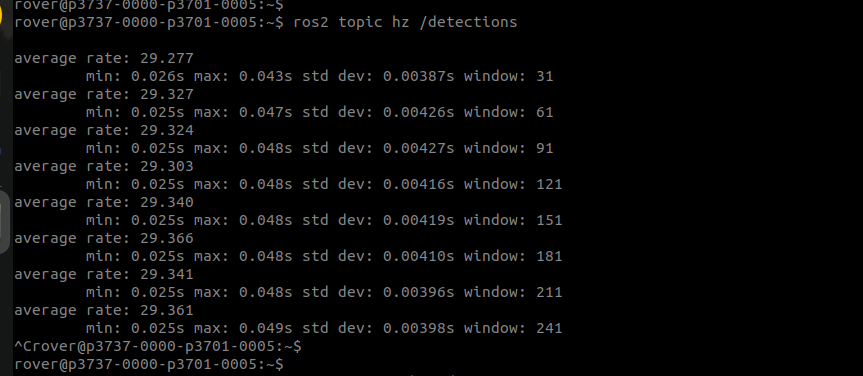

**`ros2 topic hz /detections`**: about **29.3 Hz**, min 25 ms, max about 48 ms.

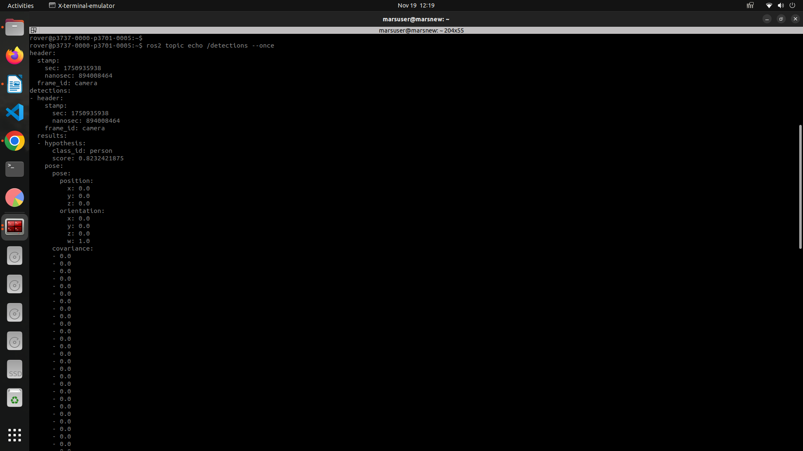

**`ros2 topic echo /detections --once`**: a `vision_msgs/Detection2DArray` with `class_id: person`, **`score: 0.8232`**, `frame_id: camera`. The video demo shows the other case: nothing is published as a detection when a hand covers the lens.

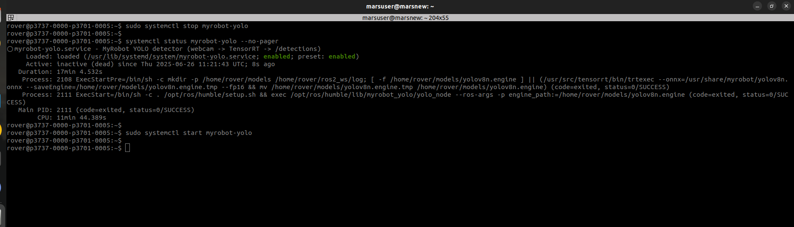

**Clean stop and restart.** After `systemctl stop`, the unit is `inactive (dead)` with `status=0/SUCCESS`, showing the exit-code fix works.

## 6. Power and boot time

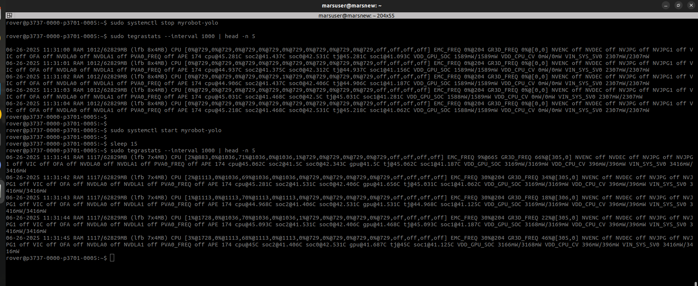

**Power with `tegrastats`** (`VIN_SYS_5V0`). Detector stopped: **2307 mW**, RAM 1012 MB. Detector running: **3416 mW**, RAM 1117 MB, GPU about 66% at the start and CPU load about 70% on one core. Power mode is `MODE_30W`.

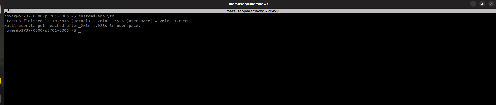

**Boot time before the fix.** `Startup finished in 10.044s (kernel) + 2min 1.055s (userspace) = 2min 11.099s`.

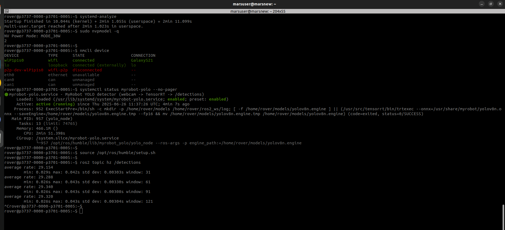

**Same system with the detector running at 29.3 Hz**, before the `networkd` units were masked. This capture shows the system healthy apart from the slow boot.

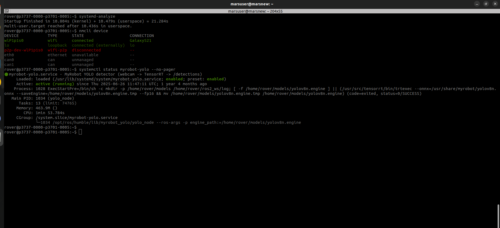

**Boot time after masking `systemd-networkd-wait-online`.** `Startup finished in 10.804s (kernel) + 10.479s (userspace) = 21.284s`, with Wi-Fi connected and the detector service running. This fix was applied live. See the note in [`LAYERS.md`](LAYERS.md).

## 7. Earlier build (7a, 2026-11-09), for history

| | |
|---|---|
| 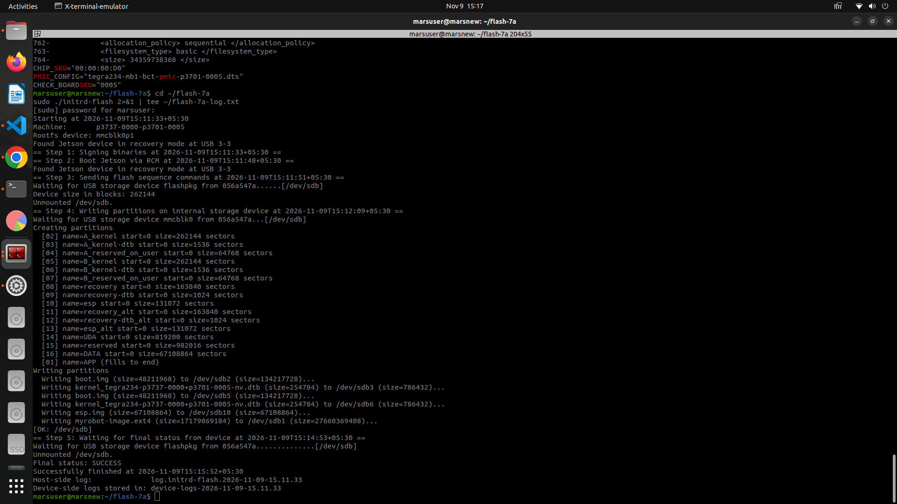 | **Flash of 7a**: first image with the `DATA` partition. |
| 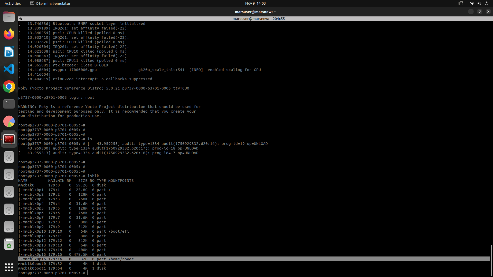 | **Partitions on 7a**: `mmcblk0p16` (32 GB) mounted on `/home/rover`. |
| 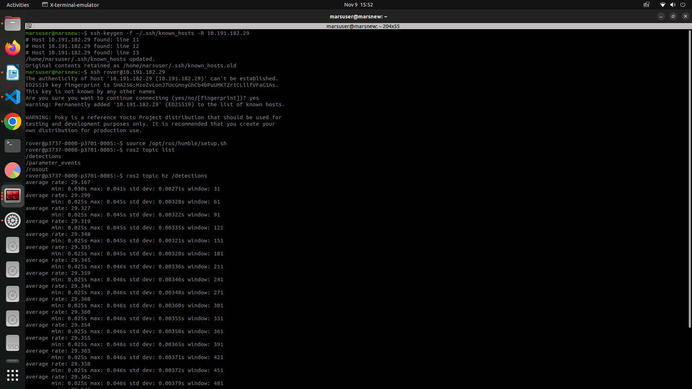 | **7a: `/detections` at 29.3 Hz** on the board over SSH. |

## 8. Gaps

- The Wi-Fi-to-laptop test (laptop seeing the topics) is shown in **video 1**, not in a screenshot.
- The "hand over the camera" case is shown in **video 2**, not in a screenshot.
- No latency test for real-time behaviour (`cyclictest`) was run.
- Screenshots of the baseline Ubuntu system are not included. Its numbers come from the text files in [`evidence/stock-baseline/`](../evidence/stock-baseline/).
